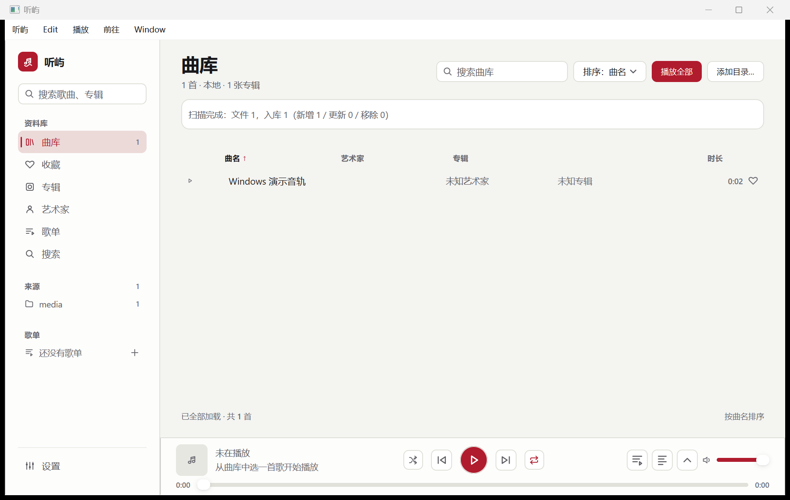
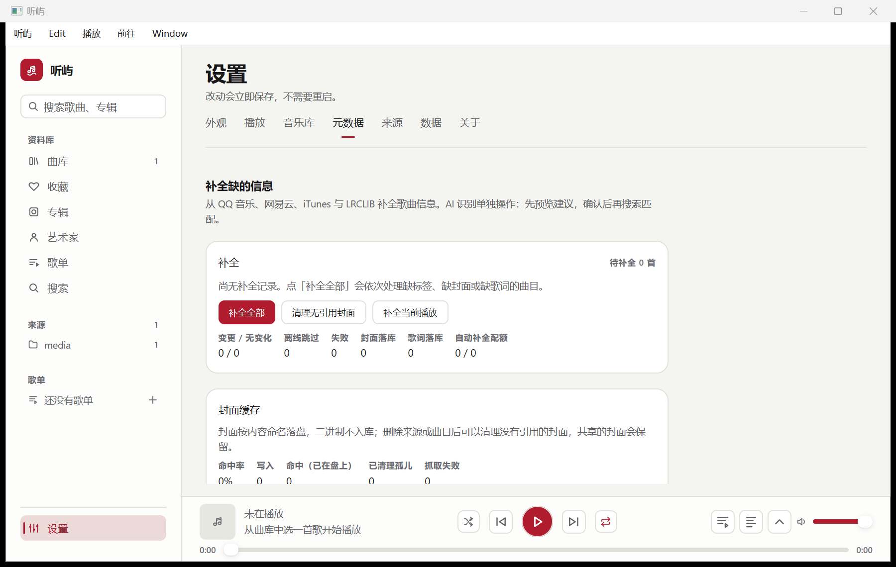

# 听屿 Windows 版

基于 [halunhaku/tingyu](https://github.com/halunhaku/tingyu) 的独立 Windows 版开发仓库。使用 Go、MyGo 和 libmpv，保留上游提交历史。原 macOS 项目说明见 [README-macos.md](README-macos.md)。

当前为开发预览版，已在 Windows 11 x64 本机完成构建、窗口交互、SQLite 持久化及播放内核验证。尚未完成干净机器分发、安装包、签名及全部云盘流程验收。

**目前请从源码构建使用，尚未发布 Windows 安装包。** 本仓库保存 Windows 版代码；macOS 原版仍由上游仓库维护。

## 界面截图

以下为当前 Windows 客户端的真实窗口截图，使用独立演示曲库和程序生成的两秒测试音轨，不包含个人音乐、账号或密钥。截图中的空封面与未知艺术家是测试音轨没有标签所致。

**曲库：目录导入、搜索、排序与底部播放控制。**



**设置 → 元数据：补全入口、执行统计与封面缓存。**



截图记录于 2026-11-01，Windows 11 x64、150% 显示缩放。截图仅展示可见界面，不代表未完成的分发验收已经通过；截图说明见 [截图记录](docs/screenshots/windows/README.md)。

## 已实现

- Windows 原生窗口、Ctrl 快捷键提示、关闭最后一个窗口退出，以及 Windows 用户数据目录。
- 复用本地曲库、播放队列、收藏、歌单和来源管理界面。
- 手动元数据重搜；手动批量补全与启动自动补全配额分离。
- 独立 AI 连接测试、服务商下拉选择、单首与批量识别；先预览建议，确认后搜索和写回。
- LRCLIB、网易云与 QQ 音乐歌词候选搜索、预览和单独保存。
- 导入 LRC/TXT 或粘贴歌词，支持 UTF-8、UTF-16 和 GB18030；保存只更新歌词，保护期间产生的新修改。

第三方元数据与歌词接口可能出现无结果、限流或服务故障，不能保证每首歌曲都可在线匹配。

## 从源码构建

在准备存放项目的目录打开 PowerShell（已经克隆的项目可从下载依赖这一步开始）：

```powershell
git clone https://github.com/halunhaku/tingyu-windows.git
cd tingyu-windows

# 下载并校验固定版本 Go、libmpv 和 SQLite，工具默认放在 G:\tingyu-windows-tools
powershell -ExecutionPolicy Bypass -File .\client\scripts\windows-setup.ps1

# 构建程序
powershell -ExecutionPolicy Bypass -File .\client\scripts\windows-build.ps1

# 启动
.\client\build\tingyu.exe
```

工具目录可用两个脚本的 `-Tools` 参数指定。构建脚本也接受 `-Go` 指定现有 Go 可执行文件。Go 版本以 [client/go.mod](client/go.mod) 为准，目前为 1.27.3。

需要 Git、Windows PowerShell 5.1 或更新版本，以及访问 Go 模块和依赖下载站点的网络。仓库目前为私有，克隆时需要有访问权限的 GitHub 登录。脚本不向系统全局安装 Go，也不修改 PATH。

没有 G 盘时，请给两个脚本指定相同的工具目录，例如：

```powershell
$toolsDir = Join-Path $env:LOCALAPPDATA "Tingyu-Windows-Tools"
powershell -ExecutionPolicy Bypass -File .\client\scripts\windows-setup.ps1 -Tools $toolsDir
powershell -ExecutionPolicy Bypass -File .\client\scripts\windows-build.ps1 -Tools $toolsDir
.\client\build\tingyu.exe
```

运行时需要保留 `client/build/mygo-sqlite3.dll` 和 `client/build/mpv/libmpv-2.dll`。单独复制 EXE 不能构成完整运行包。依赖下载地址及 SHA-256 固定在 setup 脚本中。

默认曲库目录为 `%APPDATA%\com.halunhaku.tingyu`；可通过 `TINGYU_DATA_DIR` 覆盖。`TINGYU_READ_ONLY=1` 启用只读模式。

## 首次使用

1. 启动 `client/build/tingyu.exe`，在曲库点击「添加目录…」，选择音乐所在文件夹并等待扫描完成。
2. 在曲库搜索歌曲、切换排序，使用「播放全部」或歌曲的播放入口开始播放；底部控制栏提供上一首、下一首、循环、音量和歌词入口。
3. 信息不完整时，到「设置 → 元数据」查看补全进度，也可以对单首歌曲打开匹配窗口，修改歌名、歌手、专辑后重新搜索并核对候选。
4. 歌词匹配不到时，使用单独的歌词搜索窗口切换来源、预览候选，或导入已有的 LRC/TXT 文件。

WebDAV、夸克网盘等上游来源界面保留，但 Windows 上的完整登录、凭据恢复与云盘端到端流程仍待验收。建议先用本地音乐体验。

## 自动补全、补全全部与 AI 的区别

| 入口 | 处理范围 | 是否调用 AI | 写入时机 |
| --- | --- | --- | --- |
| 启动或扫描/同步后的自动补全 | 信息不完整的歌曲，每次运行累计最多尝试 60 首 | 否 | 找到可用结果后写入曲库 |
| 设置中的「补全全部」 | 当前待补全集合，不受自动补全 60 首配额限制 | 否 | 逐首处理并写入，界面显示进度，可取消 |
| 单首匹配与重新搜索 | 当前歌曲，可调整歌名、歌手、专辑作为查询条件 | 仅点击「AI 识别」时调用 | 搜索本身不保存，核对并确认后写入 |
| 批量 AI 识别 | 默认处理信息不完整的歌曲，也可仅选择缺歌手或专辑的歌曲 | 是 | 先展示建议，勾选并点击「确认所选并搜索补全」后才搜索和写入 |

「待补全」指歌手/专辑仍是占位信息、没有封面文件记录或没有歌词的曲目；信息完整的歌曲不在批量目标中。「补全全部」并非无条件重写整个曲库，也不保证全部成功；单轮处理有 15 分钟时限，超时或取消后可再次执行。

常规补全先清理可识别的文件名信息，查询 QQ 音乐并按需回退网易云；封面还可尝试 iTunes。自动歌词先尝试 LRCLIB，再按需尝试网易云、QQ，并对额外候选核对歌名、歌手和时长，以减少错配。已有封面或歌词通常保留；在线补全可能更新歌名、歌手和专辑，重要曲库建议先备份。结果保存到应用曲库数据库，不会把标签写回原始音频文件。

如不想启动后自动联网补全，可在启动程序前设置（手动入口仍可用）：

```powershell
$env:TINGYU_ENRICH_AUTO = "0"
.\client\build\tingyu.exe
```

## 使用歌词和 AI

- 歌曲右键选择「搜索歌词…」，或在歌词页点击「搜索歌词 / 导入」。可修改搜索条件、选择来源预览、导入文件或粘贴内容，点击「保存歌词」后生效。
- 设置 → 元数据：配置 OpenAI 兼容服务并测试连接，保存后使用单首或批量 AI 识别。识别阶段不修改曲库，确认后才搜索补全。AI 不生成歌词。
- API 密钥通过系统凭据接口保存，不写入仓库。请勿提交真实曲库、音乐文件或登录信息。

### AI 配置与批量识别

1. 打开「设置 → 元数据」，启用 AI，使用服务商下拉框选择预设，填写接口地址、模型及 API Key。本地 Ollama 可不填密钥。
2. 点击「测试连接」验证当前填写的配置；测试会实际发送一次简短模型请求，可能产生少量费用。通过后点击「保存 AI 配置」。
3. 单首在匹配窗口点击「AI 识别」；多首在设置页选择批量范围，点击「开始批量 AI 识别」。
4. 查看建议，取消不合适的勾选，再点击「确认所选并搜索补全」。错误建议不要直接采用，可改查询条件后手动搜索。

AI 使用歌曲的文字信息推断歌名、歌手和专辑，**不分析音频声纹，不生成歌词**。文字信息会发送给所配置的 AI 服务；批量调用可能产生费用。取消识别后已获得的建议仍可查看。系统凭据接口的完整 Windows 安全存储、长值分片和恢复验收仍在待办中。

### 歌词搜索、预览与导入

在「搜索歌词…」窗口修改歌名、歌手或专辑并重新搜索，可查看 LRCLIB、网易云和 QQ 音乐的候选。先预览并确认歌曲版本，再点击「保存歌词」。单独保存歌词只更新歌词字段；若歌曲在打开窗口后被其他操作改动，需重新载入后确认。

网络没有结果时，可导入合法获得的 `.lrc` / `.txt` 文件或粘贴歌词。支持 UTF-8（含 BOM）、UTF-16 和 GB18030，文件上限 2 MB。带有效时间戳的 LRC 可随播放高亮；纯文本没有逐句时间信息。

## 数据目录与备份

关闭程序后备份 `%APPDATA%\com.halunhaku.tingyu`，其中包含 `library.sqlite` 等应用数据；原始音乐文件需要另外备份。不要在程序写库期间直接替换数据库。系统凭据不属于普通曲库备份，迁移电脑后可能需要重新配置。

使用独立目录试用时，可在 PowerShell 中运行：

```powershell
$env:TINGYU_DATA_DIR = Join-Path $env:LOCALAPPDATA "Tingyu-Windows-Demo"
.\client\build\tingyu.exe
```

环境变量作用于当前 PowerShell 及其启动的程序；可使用 `Remove-Item Env:TINGYU_DATA_DIR -ErrorAction SilentlyContinue` 恢复默认目录。不要同时启动多个实例操作同一个曲库。

## 常见问题

| 情况 | 检查与处理 |
| --- | --- |
| 双击 EXE 无法正常启动或提示缺少 DLL | 先执行 setup，再执行 build，保留整个运行目录中的 SQLite 和 mpv 依赖；查看启动日志 |
| 点击补全后暂时没有结果 | 大曲库逐首联网可能需要较长时间；查看设置页进度、是否已有任务、网络和只读状态；可取消 |
| LRCLIB 返回 404，或其他来源无歌词 | 表示该次查询没有找到内容，不能据此认定所有来源都没有；改歌名/歌手后重搜，尝试其他来源或手动导入 |
| 找到歌词但版本不对 | 核对现场版、翻唱、混音及歌曲时长，预览后再保存 |
| AI 测试失败 | 检查接口地址、模型名、密钥、网络及服务端权限/额度；成功后还需保存配置 |
| 能查看但不能保存或补全 | 检查 `TINGYU_READ_ONLY` 和数据目录写权限，关闭程序后调整再启动 |

需要记录启动问题时，可设置 `$env:TINGYU_STARTUP_LOG = Join-Path $env:TEMP "tingyu-startup.log"` 后再启动。提交日志或截图前请检查并移除私人路径、歌曲信息和服务凭据。

## 验证与当前限制

近期修改通过 metadata、ui-model、shell、app、enrich 测试，以及 library 相关定向测试；QQ 歌词接口已进行实网验证。窗口、数据库、动态库及播放验证记录见 [Windows W0 记录](docs/windows-w0.md)。

仍待完成：干净机器安装、人工听感验收、Windows 10/ARM64、安装包与签名、完整云盘凭据流程、独立最终审核及 Windows CI。现有 macOS 构建配置保留用于参考。

开发者可从仓库根目录运行以下构建及测试命令；完整测试会包含数据库和界面相关测试，所需时间可能较长：

```powershell
powershell -ExecutionPolicy Bypass -File .\client\scripts\windows-build.ps1 -Test
```

主要代码：`client/internal/app` 负责应用接线，`library` 负责曲库与 SQLite，`metadata` / `enrich` 负责在线查询与补全，`ui` 负责界面，`mpv` 负责播放内核。更详细的历史客户端说明见 [client/README.md](client/README.md)，其中 macOS 打包命令不适用于 Windows。

## 许可证

应用源码沿用 [MIT](LICENSE)。libmpv、FFmpeg、SQLite 等外部依赖各有许可证；发布二进制包前应按实际版本核对并履行再分发要求。本仓库不提交本地构建产物和用户数据。
