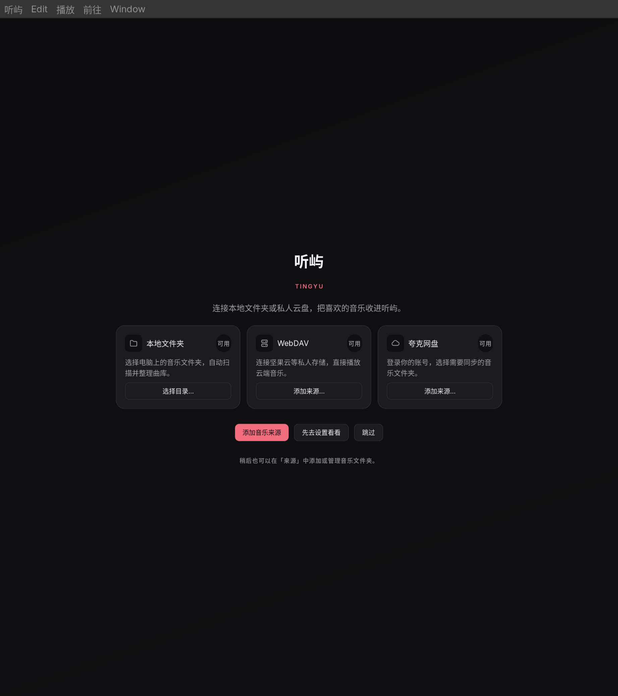

# 听屿 Omarchy 版

基于 [halunhaku/tingyu](https://github.com/halunhaku/tingyu) 的独立 Omarchy（Linux）版开发仓库。沿用 Go、MyGo 和 libmpv 的客户端，界面与 Windows 版同源。Windows 版说明见 [README-windows.md](README-windows.md)，macOS 原版见 [README-macos.md](README-macos.md)。

当前为开发预览版：构建、窗口、曲库、播放内核、MPRIS、Omarchy 主题跟随与本地安装都已在本机跑通，**出声证据、云盘与分发发布尚未验收**。



## 已跑通

| 项 | 证据 |
|---|---|
| 构建与测试 | Go 1.27.3、`CGO_ENABLED=0`；`go test -short ./...` 全绿；`GOOS=windows`/`darwin` 交叉编译通过；CI（`linux.yml`）每次推送都跑 |
| 窗口 | Hyprland/Wayland 下开窗，从 `main` 到就绪约 190–300 ms，1.6 分数缩放下渲染正常 |
| 曲库与数据目录 | XDG 路径 `~/.local/share/com.halunhaku.tingyu`（相对的 `XDG_DATA_HOME` 按规范忽略），`TINGYU_DATA_DIR` 可覆盖 |
| 播放内核 | 系统 libmpv 0.41 按 `libmpv.so.2` → `.1` → `.0` 自动加载，client API 2.5，不需要 `MPV_LIB` |
| 播放验收 | 内置 harness 在 Linux 上 24/25：9 种格式 + seek、远端鉴权/Range/无长度流、gapless、loop、倍速、音量全过；`queue-200` 未过（见下） |
| MPRIS | `playerctl` 可见可控：title/artist/album/`mpris:length`/封面都对，`play-pause`、`next`、`previous`、`position` 生效；播完为 `Stopped`，换曲位置归零 |
| 桌面观感 | 跟随 Omarchy 的 `accent` 与 Hyprland 的 `decoration:rounding`，主题切换 2 秒内生效；设置页有「跟随桌面主题」开关 |
| 文件对话框 | 走 `xdg-desktop-portal`（进程内 GTK 选择器在 Hyprland 下会把确认按钮摆到屏幕外） |
| 桌面集成 | 「显示所在文件夹」走 `FileManager1`，失败回退 `xdg-open`；一库一实例，第二次启动只是把窗口提到前台 |
| 安装 | `./scripts/linux-install.sh` 装到 `~/.local/bin` + 应用启动器，无 root；`pkgbuild/PKGBUILD` 可 `makepkg` 出包 |

## 从源码构建

需要 x86_64 的 Omarchy，以及网络访问 Go 模块与下载站点。脚本不向系统安装 Go，也不改 PATH；工具链默认放在 `~/.local/share/tingyu-tools`，可用 `--tools` 或 `TINGYU_TOOLS` 指定。

```bash
git clone https://github.com/halunhaku/tingyu-omarchy.git
cd tingyu-omarchy/client

# 下载并校验 Go 1.27.3，顺带检查运行库
./scripts/linux-setup.sh

# 构建 build/tingyu
./scripts/linux-build.sh

# 安装到用户目录，出现在应用启动器里（无 root）
./scripts/linux-install.sh

# 或者直接启动（会自动使用系统 libmpv）
./build/tingyu
```

运行库由 Omarchy 自带：`gtk3`、`webkit2gtk-4.1`、`libsecret`、`mpv`。

## 已知限制

- **窗口标识**：Wayland 的 app id 取二进制名（`tingyu`），`.desktop` 里用 `StartupWMClass=tingyu` 对齐。
- **`queue-200`**：harness 观测到 201 次加载而队列长度是 200，原因在查（详见计划文档 §3.1）。
- **出声**：AO 后端、采样率、underrun、结尾事件尚无原始证据，只有内核位置推进；人耳试听也还没做。
- **真键盘媒体键**：只用 `playerctl` 模拟过，Omarchy 的真实链路（Hyprland → omarchy-shell → MPRIS）未按过。
- **云盘**：WebDAV 与夸克登录、二维码流程未在 Linux 上验。
- **未验收**：真实出声、硬件解码、媒体键、MPRIS 控件、拖入目录、云盘登录、二维码登录。
- **性能门槛**：`internal/shell` 的 10000 行滚动 p95 闸门（16.7 ms）在本机实测 16.7–17.6 ms，临界失败；`go test -short` 跳过它，默认 `go test ./...` 仍然执行。
- **分发**：已有 PKGBUILD、`.desktop` 与图标，尚未发布 tag 与 GitHub Release，也没有加入 Omarchy 的软件包源。

## 项目文档

- [迁移范围与里程碑](docs/plan/2026-11-12-omarchy-migration-scope.md)
- [设计说明](DESIGN.md)
- 上游 macOS 版：<https://github.com/halunhaku/tingyu>
